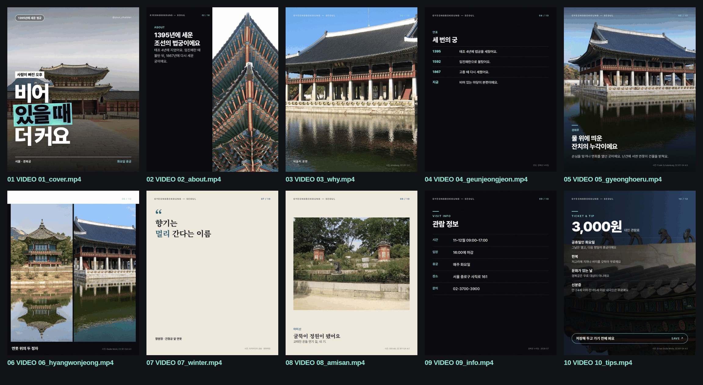
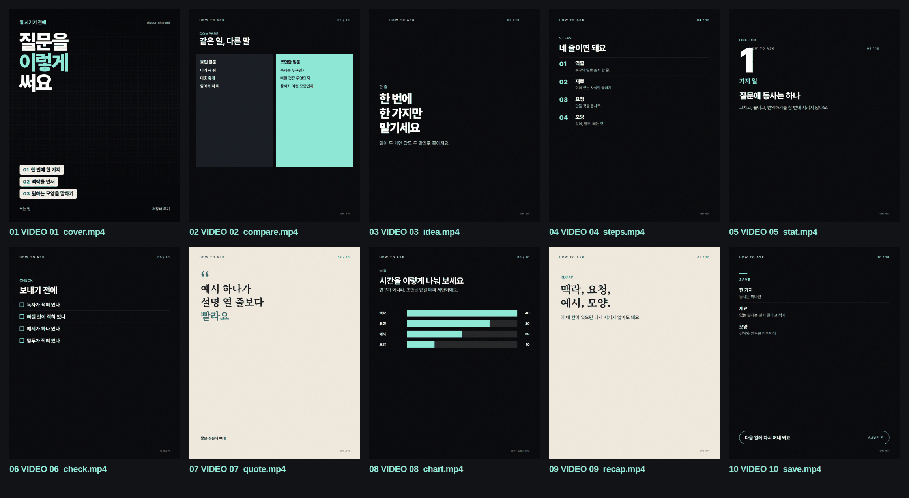

# 카드뉴스

주제를 하나 주면, 그 주제로 인스타 카드뉴스 10장(4:5), 캡션, X 글, 나레이션, 릴스(9:16)를 만드는 Claude Code 스킬이에요. 뉴스, 방법, 목록, 비교, 이야기, 숫자, 장소 어디든 돼요.

색과 글자는 같아요. 배경은 거의 검고, 포인트는 제이드(`#8FE8D6`)예요. 장은 판형이 바뀌어요. 큰 문장, 숫자, 비교, 순서, 차트, 인용, 사진, 한지. 바로 앞 장과 같은 판형을 쓰지 않아요. 글자는 HTML로 그려요.





## 설치

저장소를 받은 다음, 스킬 폴더에서 준비 스크립트를 먼저 실행해요. 이미 있는 프로그램은 건너뛰어요.

```bash
mkdir -p ~/.claude/skills
cp -R plugins/cardnews/skills/cardnews ~/.claude/skills/cardnews
cd ~/.claude/skills/cardnews
bash scripts/setup.sh
```

맥에서는 Homebrew로 없는 것만 넣어요.

- `brew install ffmpeg` (ffprobe 포함)
- `brew install yt-dlp`
- Playwright로 헤드리스 Chromium
- Pretendard, 커버 B용 Noto Serif KR (스킬 폴더의 글꼴 파일)

윈도우 PowerShell에서는 스킬 폴더에서 이 명령을 실행해요. 없는 것만 winget으로 넣고, winget이 없으면 Chocolatey를 써요. 관리자 확인 창이 뜨면 "예"를 누르면 돼요.

```powershell
powershell -ExecutionPolicy Bypass -File scripts/setup.ps1
```

- `winget install OpenJS.NodeJS.LTS` (node가 없을 때. 없으면 `choco install nodejs-lts`)
- `winget install Gyan.FFmpeg` (ffprobe 포함. 없으면 `choco install ffmpeg`)
- `winget install yt-dlp.yt-dlp` (없으면 `choco install yt-dlp`, 그래도 없으면 `yt-dlp.exe`를 `~\.local\bin`에 받아요)
- Playwright 헤드리스 Chromium, Pretendard, 커버 B용 Noto Serif KR

Git Bash를 쓰는 경우에는 `bash scripts/setup.sh` 가 같은 일을 해요. `C:\영상\clip.mp4` 처럼 넘긴 경로는 스크립트가 `/c/영상/clip.mp4` 로 바꿔요. 카드 렌더는 `node scripts/render-episode.mjs` 라서 PowerShell에서도 경로에 공백이나 한글이 있어도 돼요.

winget으로 방금 깐 프로그램은 같은 창에서 바로 안 보일 수 있어서, 스크립트들이 winget 설치 폴더를 PATH 앞에 붙여요. 그래도 안 보이면 터미널을 다시 열어요.

Node 20이 없으면 맥에서는 `brew install node`를 시도해요. 리눅스는 ffmpeg·yt-dlp가 없고 sudo가 비밀번호 없이 될 때만 apt로 넣고, 아니면 필요한 명령을 한글로 알려 줘요. 한 번 더 실행해도 안전해요.

## 플러그인으로 설치

이 저장소 루트에 마켓 목록이 있어요.

```bash
claude plugin marketplace add dosankim/cardnews-skill
claude plugin install cardnews@cardnews
```

받은 폴더에서 바로 시험할 때는:

```bash
claude --plugin-dir ./plugins/cardnews
```

설치 뒤 Claude에게 "이 주제로 카드뉴스 만들어 줘"라고 하면 스킬이 붙어요. `/cardnews:cardnews`로 직접 부를 수도 있어요.

## 한 편 만들기

주제는 사람이 정해요. 전시 편은 지금 열린 곳을 제안할 수 있지만, 고르기 전에는 만들지 않아요. 자료는 기관 공식 페이지에서 확인하고, 공식 유튜브에서 필요한 구간만 받아요. 얼굴이 보이는 컷은 빼요.

스킬 폴더에서, 렌더 전에 준비를 한 번 돌려요. 맥·리눅스·Git Bash는 `bash scripts/setup.sh`, Windows PowerShell은 `powershell -ExecutionPolicy Bypass -File scripts/setup.ps1`.

```bash
bash scripts/check-deps.sh
node scripts/render-episode.mjs /경로/episode.json
```

`episode.json`에 문장, 사진 경로, 커버(A/B/C)를 적어요. 예시는 `examples/01.경복궁_서울/`이에요.

결과 폴더:

- `01_….png`, `01_….mp4` … 10장. 영상은 약 8초, 소리 없음
- `reel.mp4` 세로 영상. 음악 없음
- `contact_sheet.png`
- `기획서.md` `게시글문구.txt` `X글.txt` `나레이션대본.txt`

영상까지 만들면 컴퓨터에 따라 몇 분 걸려요(맥 M 시리즈에서 10장과 릴스가 약 1분). 카드 이미지만 먼저 보려면:

```bash
node scripts/render-episode.mjs episode.json --stills-only
```

표지 세 장을 보려면:

```bash
node scripts/render-episode.mjs episode.json --preview-themes --stills-only
```

소리는 기본으로 안 넣어요. 음악 파일이 있으면 `--audio 파일`. 나레이션 목소리는 `--tts`인데, `edge-tts`가 설치돼 있을 때만 동작해요. 둘 다 있으면 음악은 나레이션 아래로 줄어들어요. 박자가 분명하면 컷을 그 박에 맞춰요.

릴스는 Remotion으로 그려요. 글자가 한 줄씩 나오고, 제이드 상자가 그려지고, 숫자는 올라가고, 사진은 천천히 움직이고, 장면은 프리셋에 따라 겹치거나 밀려요. 프리셋은 `editorial`, `kinetic`, `push`, `tally` 네 가지예요. `episode.json`의 `reel.preset`으로 고르고, 없으면 갈래에 맞는 것을 써요. Remotion이 없으면 예전처럼 ffmpeg가 스틸 위에 글자를 얹어요.

HeyGen HyperFrames는 HTML을 영상으로 만드는 공개 도구예요. 검토한 뒤 이번 릴스에는 쓰지 않았어요. 단어 등장, 숫자 카운트, 장면이 겹치는 시간은 Remotion 타임라인이 맞고, 렌더러를 둘 두면 설치만 무거워져요.

## 샘플

위에 두 장의 연락용 시트가 있어요.

- `examples/01.경복궁_서울`은 장소 편이에요. 표지, 스플릿, 사진, 연표, 그리드, 인용, 액자, 정보, 팁이 번갈아 나와요. 사진은 위키미디어 공용과 문화재청 공개 사진이고, 시간은 궁능유적본부 안내로 확인했어요. 받은 영상은 없어서 사진 장만 천천히 줌하고, 글자 판형은 그대로 멈춰요.
- `examples/02.질문_잘쓰기`는 방법 편이에요. 사진 없이 비교, 순서, 숫자, 체크, 인용, 차트로 갔어요. 차트의 40·30·20·10은 연구가 아니라 시간을 나누는 제안이고, 카드와 기획서에 그렇게 적혀 있어요.

## 알아둘 점

- 시간, 요금, 휴관은 공식 페이지에서 다시 확인한 뒤에 카드에 써요.
- 사람 얼굴이 보이는 컷은 쓰지 않아요.
- 기관 영상을 올리는 건 게시 전에 홍보팀 허락을 받는 게 좋아요.
- 인스타에 올리거나 예약하는 기능은 없어요.
- 글꼴은 Pretendard(SIL OFL)와 Noto Serif KR(커버 B, SIL OFL)이에요.
